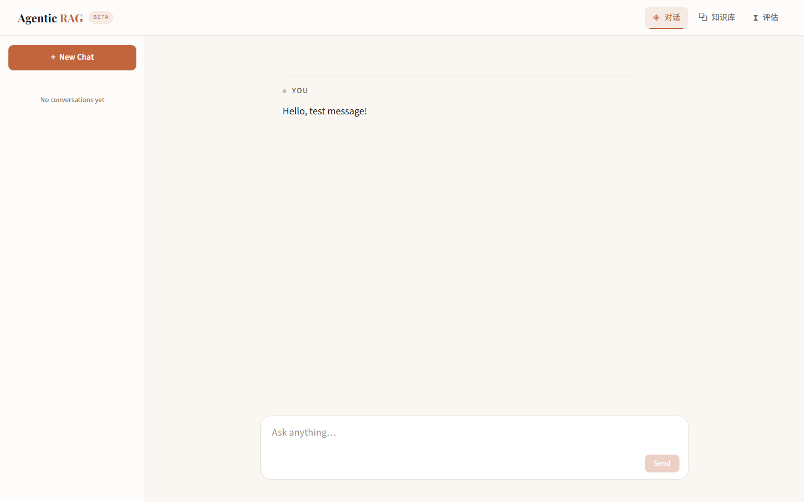

# 业务文档智能问答平台

基于 LangGraph 的 RAG 问答系统。回答可溯源到原文章节，检索质量用金标集和对照实验验证。



## 这是什么

上传 PDF / Word / Markdown 后可以提问，每条回答都标注依据的原文位置，点开能核对。

大部分 RAG 项目的终点是「能答出来」。但实际用起来卡住的是另外三件事：答得对不对、依据是哪一段、相似问题能不能更快。这个项目主要是围绕这三点做的。

## 核心能力

### 混合检索

BGE-M3 稠密检索 + BM25 稀疏检索，两路各召回 10 个，RRF 融合后经 Cross-Encoder 精排 10 选 4。精排模型缺失时自动退回 RRF 顺序，不影响可用性。

两路都做是因为各有盲区：向量能匹配「劳动关系终止」和「解除劳动合同」这类同义表达，但专有名词和缩写经常漏；BM25 相反，词面对得上就必中，换个说法就找不到。

不过实测发现融合不一定更好——在这份语料上 RRF 反而低于纯向量（nDCG 0.775 → 0.682）。原因是融合按名次投票，向量侧明显更强时会把 BM25 的贡献冲淡。混合检索的价值前提是两路都够强，这一点值得先验证再上。

### 跨语言检索

中文提问、英文语料时词面对不上，「常量传播分析怎么做」原本完全召不回（nDCG = 0）。做法是从语料自动挖掘中英术语对（词频 + 章节标题两个来源），检索前给中文 query 补上对应英文术语。

只作用于 BM25 一路。向量靠语义匹配，追加英文反而会稀释中文信号。

效果：BM25 的 nDCG 从 0.297 提升到 0.629（t=3.48，10 胜 1 负）。术语只加 1 个而不是 3 个——BM25 是词袋模型，加多了通用词会把精确匹配挤下去。

### Agent 编排

LangGraph 六节点状态机：

```
START → plan →(需检索)→ retrieve → agent →(调工具)→ tools ┐
            │              ↑                  ↑            │
            └(不需要)→─────┘←─────────────────┴────────────┘
                                                  ↓
                                             reflect →(资料不足)→ retrieve（最多一次）
                                                  ↓
                                               answer → END
```

`plan` 判断要不要检索，寒暄类问题直接跳过整个检索链路（16.6s → 2.1s）。`reflect` 自检资料是否充分，不足则补检索一次，只补一次以保证延迟可控。

节点内用 `get_stream_writer()` 外发事件，外层 `astream(stream_mode="custom")` 接收。事件形状与迁移前的自研循环完全一致，前端没有改动。

### 三层记忆

| 层 | 内容 | 实现 |
|---|---|---|
| 短期 | 会话内最近 N 轮 + 滚动摘要 | 水位线增量摘要，不丢中间消息 |
| 长期 | 用户偏好、已确认事实 | MySQL + Chroma，规则触发式抽取 |
| 语义缓存 | 相似问题直接复用答案 | 阈值 0.90 + 168h TTL |

语义缓存命中时跳过检索与生成：同一问题二次提问从 16.6s 降到 0.2s。

## 快速开始

**前置**：Python 3.13+、Node.js 20+、MySQL 8.0、约 5GB 磁盘（两个 BGE 模型）

```bash
git clone https://github.com/Frankie-GUAN/RAG-based-ai-assistant.git
cd RAG-based-ai-assistant

# 1. 依赖
python -m venv .venv
.venv\Scripts\activate              # Windows（macOS/Linux: source .venv/bin/activate）
pip install -r backend/requirements.txt
cd frontend && npm install && cd ..

# 2. 配置（必填 DEEPSEEK_API_KEY，其余有默认值）
cp backend/.env.example backend/.env
```

**3. 启动后端**（必须 `cd backend`，否则 `app` 包无法解析）

```bash
cd backend
uvicorn app.main:app --reload --port 8000
```

首次启动加载两个模型约 1 分钟。可设 `PRELOAD_MODELS=false` 跳过。

**4. 启动前端**

```bash
cd frontend
npm run dev
```

打开 http://localhost:5173 ，API 文档 http://localhost:8000/docs 。

**5. 入库文档**（首次必做，仓库不带索引）

把 PDF / TXT / MD / DOCX 放进 `data/uploads/`，然后：

```bash
cd backend
python -m app.rag.ingest --fresh
```

约 30 秒/份。也可以在「知识库」页面点上传。

**验证安装**

```bash
cd backend
python -m pytest tests/ -q          # 期望 260 passed
```

## 技术栈

| 层 | 技术 |
|---|---|
| 前端 | Vue 3 + Vite + TypeScript + Pinia + Tailwind CSS v4 |
| 后端 | FastAPI + LangChain + LangGraph |
| 模型 | DeepSeek（LLM）、BGE-M3（嵌入）、BGE-Reranker-v2-m3（精排），后两者本地 CPU 推理 |
| 存储 | ChromaDB（向量）、MySQL 8.0（会话与文档） |
| 工具层 | MCP 2.2.0（同进程 InMemoryTransport） |

